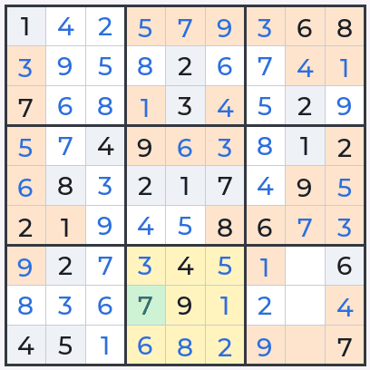

<!-- Written by tools/walkthrough.py extra-regions: edit the script, not this page. -->
# Extra Regions, step 51: the 7 in box 8

**Step 51 of 54** · [← Step 50](step-50.md) · [All steps](../extra-regions.md#the-whole-puzzle-step-by-step) · [Step 52 →](step-52.md)

Box 8 needs a 7, and r8c4 is its last empty cell: **r8c4 = 7**.

**Step 51 of 54** · [← Step 50](step-50.md) · [All steps](../extra-regions.md#the-whole-puzzle-step-by-step) · [Step 52 →](step-52.md)
