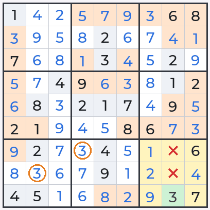

<!-- Written by tools/walkthrough.py extra-regions: edit the script, not this page. -->
# Extra Regions, step 52: the 3 in box 9

**Step 52 of 54** · [← Step 51](step-51.md) · [All steps](../extra-regions.md#the-whole-puzzle-step-by-step) · [Step 53 →](step-53.md)

Box 9 needs a 3. r7c8: row 7 has one (r7c4). r8c8: row 8 has one (r8c2). Only **r9c8** is left: **r9c8 = 3**.

**Step 52 of 54** · [← Step 51](step-51.md) · [All steps](../extra-regions.md#the-whole-puzzle-step-by-step) · [Step 53 →](step-53.md)
