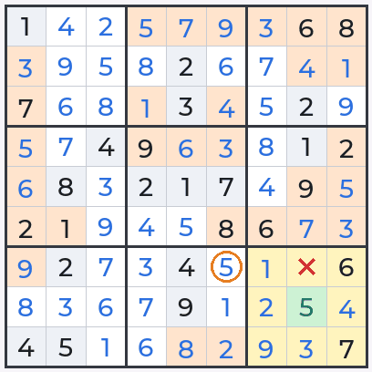

<!-- Written by tools/walkthrough.py extra-regions: edit the script, not this page. -->
# Extra Regions, step 53: the 5 in box 9

**Step 53 of 54** · [← Step 52](step-52.md) · [All steps](../extra-regions.md#the-whole-puzzle-step-by-step) · [Step 54 →](step-54.md)

Box 9 needs a 5. r7c8: row 7 has one (r7c6). Only **r8c8** is left: **r8c8 = 5**.

**Step 53 of 54** · [← Step 52](step-52.md) · [All steps](../extra-regions.md#the-whole-puzzle-step-by-step) · [Step 54 →](step-54.md)
