# Fortress

[← All variants](README.md) · [Puzzles](../features-puzzles.md) · [How to play](../how-to-play.md)

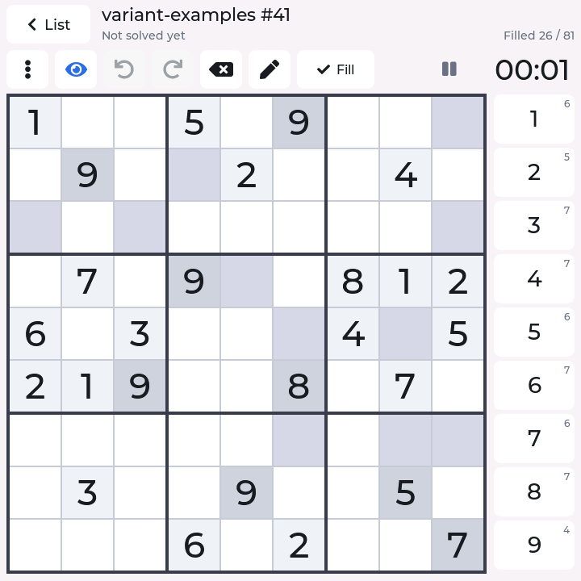

## The rules

[Classic](classic.md) rules, plus **grey cells**: each grey cell holds a **bigger digit than every white cell side by side with it** (left, right, above, below). Two grey cells side by side can be either way round, and cells that only touch at a corner don't count.

## On the board

- Grey cells are shaded, a little darker than Even-Odd's even cells; there are no signs to read.
- A grey 1 turns red at once (it can't beat anything); a grey digit and a white neighbour that's bigger turn red together.
- The grader and hints narrow the cells around the grey ones: "The grey cells (bigger than their white neighbours) around row 5, column 6 leave it only 7".
- **Puzzles → ⋮ → New puzzle → Marks → Fortress**: 18 to 24 grey cells.

## How to solve it

- **Grey is never 1, white next to grey is never 9.** Rule those out first.
- **Count the white neighbours:** a grey cell with white cells on both sides in its row (or column) beats two different digits, so it's at least 3; the more white neighbours, the higher it starts.
- **Look from the white side too:** a white cell next to a grey 5 is at most 4; next to two grey cells, it's below the smaller of them.
- **The 9s are grey or far from grey:** a 9 in a white cell can't be next to any grey one.

## Worked example

**variant-examples #41**, Fortress Easy (see [Classic](classic.md#worked-example-the-whole-puzzle) for how to import the examples; cells are written r*row*c*column*). The grey cells are in the screenshot; these matter here:

- r5c6 is grey, next to the white 4 in r5c7;
- r8c8 (a 5) is grey, with white cells to its left (r8c7) and right (r8c9) and below it (r9c8).

**Step 1: r5c6, a grey cell.** Row 5 has 3, 4, 5 and 6; column 6 has 2, 8 and 9; that leaves 1 and 7. r5c6 is grey and r5c7 next to it is a white 4, so it's bigger than 4. **r5c6 = 7**.

**Step 2: r9c8, under a grey 5.** Row 9 has 2, 6 and 7; column 8 has 1, 4 and 5; that leaves 3, 8 and 9. r9c8 is white, and the grey 5 above it in r8c8 must be bigger, so it's smaller than 5. **r9c8 = 3**.

**Step 3: the 6 in row 8.** Row 8 needs a 6. r8c1, r8c4 and r8c6 see the 6s in column 1, column 4 and box 8; r8c2, r8c5 and r8c8 are filled. r8c7 and r8c9 are white cells either side of the grey 5 in r8c8, so they're smaller than 5. Only **r8c3** is left: **r8c3 = 6**.

## The whole puzzle, step by step

<!-- walkthrough -->
<!-- Written by tools/walkthrough.py fortress: edit the script, not this part. -->

The whole puzzle, from the start to the last cell: 55 steps, each one a single (one place left for a digit, or one digit left for a cell), taken in the order a box's single comes first, so not quite the order of the worked example above. In each picture, the unit the step looks at is tinted yellow (for a cell with one digit left: its row, column and box), the new digit is on green, the digits that rule cells out have an **orange ring**, and the empty cells they rule out a **red cross**. Givens are on grey, digits from earlier steps in blue.

#### Step 1: the 8 in box 4

Box 4 needs an 8. r4c1 and r4c3: row 4 has one (r4c7). Only **r5c2** is left: **r5c2 = 8**.

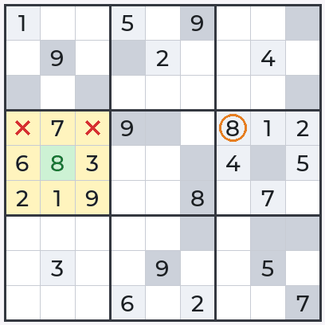

#### Step 2: the 2 in box 5

Box 5 needs a 2. r4c5 and r4c6: row 4 has one (r4c9). r5c5: column 5 has one (r2c5). r5c6: column 6 has one (r9c6). r6c4 and r6c5: row 6 has one (r6c1). Only **r5c4** is left: **r5c4 = 2**.

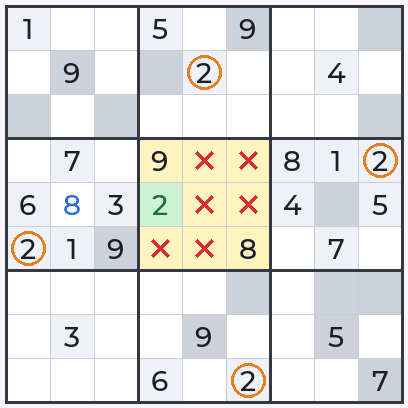

#### Step 3: the 1 in box 5

Box 5 needs a 1. r4c5 and r4c6: row 4 has one (r4c8). r6c4 and r6c5: row 6 has one (r6c2). r5c6: it's grey, bigger than a white cell next to it, so it isn't 1. Only **r5c5** is left: **r5c5 = 1**.

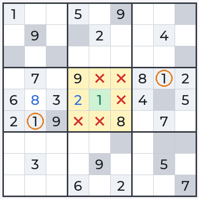

#### Step 4: the 7 in box 5

Box 5 needs a 7. r4c5 and r4c6: row 4 has one (r4c2). r6c4 and r6c5: row 6 has one (r6c8). Only **r5c6** is left: **r5c6 = 7**.

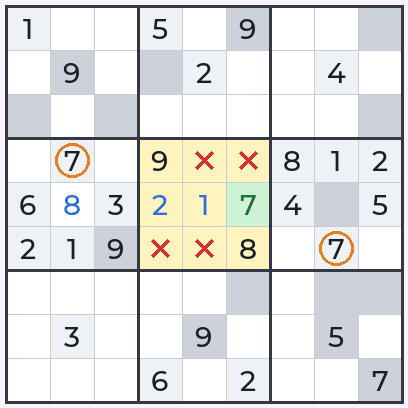

#### Step 5: the 9 in box 6

Box 6 needs a 9. r6c7 and r6c9: row 6 has one (r6c3). Only **r5c8** is left: **r5c8 = 9**.

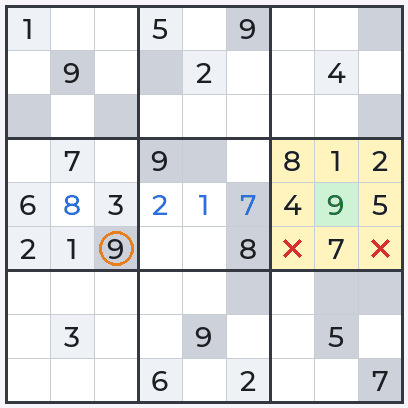

#### Step 6: the 5 in row 6

Row 6 needs a 5. r6c4: column 4 has one (r1c4). r6c7: box 6 has one (r5c9). r6c9: column 9 has one (r5c9). Only **r6c5** is left: **r6c5 = 5**.

#### Step 7: the 5 in box 8

Box 8 needs a 5. r7c4: column 4 has one (r1c4). r7c5 and r9c5: column 5 has one (r6c5). r8c4 and r8c6: row 8 has one (r8c8). Only **r7c6** is left: **r7c6 = 5**.

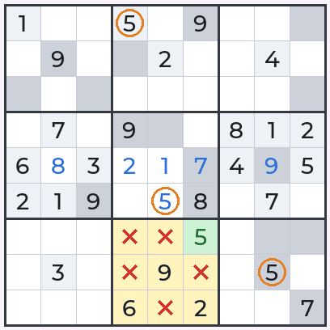

#### Step 8: the 6 in box 9

Box 9 needs a 6. r9c7 and r9c8: row 9 has one (r9c4). r7c7: it's white, so it's smaller than the grey 5 in r7c6 next to it. r7c8: it's grey, so it's bigger than the white 7 in r6c8 next to it. r8c7 and r8c9: it's white, so it's smaller than the grey 5 in r8c8 next to it. Only **r7c9** is left: **r7c9 = 6**.

#### Step 9: the 6 in box 6

Box 6 needs a 6. r6c9: column 9 has one (r7c9). Only **r6c7** is left: **r6c7 = 6**.

#### Step 10: the 3 in box 6

Box 6 needs a 3, and r6c9 is its last empty cell: **r6c9 = 3**.

#### Step 11: the 6 in box 7

Box 7 needs a 6. r7c1, r7c2 and r7c3: row 7 has one (r7c9). r8c1: column 1 has one (r5c1). r9c1, r9c2 and r9c3: row 9 has one (r9c4). Only **r8c3** is left: **r8c3 = 6**.

#### Step 12: the 4 in box 9

Box 9 needs a 4. r7c7, r8c7 and r9c7: column 7 has one (r5c7). r7c8 and r9c8: column 8 has one (r2c8). Only **r8c9** is left: **r8c9 = 4**.

#### Step 13: the 8 in box 9

Box 9 needs an 8. r7c7, r8c7 and r9c7: column 7 has one (r4c7). r9c8: it's white, so it's smaller than the grey 7 in r9c9 next to it. Only **r7c8** is left: **r7c8 = 8**.

#### Step 14: the 9 in box 9

Box 9 needs a 9. r8c7: row 8 has one (r8c5). r9c8: column 8 has one (r5c8). r7c7: it's next to a grey cell, which is bigger, so it isn't 9. Only **r9c7** is left: **r9c7 = 9**.

#### Step 15: the 9 in box 3

Box 3 needs a 9. r1c7, r1c8 and r1c9: row 1 has one (r1c6). r2c7 and r2c9: row 2 has one (r2c2). r3c7: column 7 has one (r9c7). r3c8: column 8 has one (r5c8). Only **r3c9** is left: **r3c9 = 9**.

#### Step 16: the 9 in box 7

Box 7 needs a 9. r7c2: column 2 has one (r2c2). r7c3: column 3 has one (r6c3). r8c1: row 8 has one (r8c5). r9c1, r9c2 and r9c3: row 9 has one (r9c7). Only **r7c1** is left: **r7c1 = 9**.

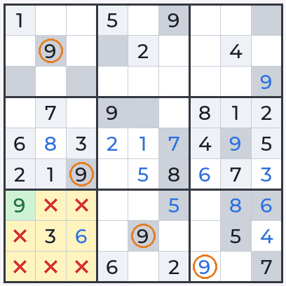

#### Step 17: the 6 in row 2

Row 2 needs a 6. r2c1: column 1 has one (r5c1). r2c3: column 3 has one (r8c3). r2c4: column 4 has one (r9c4). r2c7: column 7 has one (r6c7). r2c9: column 9 has one (r7c9). Only **r2c6** is left: **r2c6 = 6**.

#### Step 18: the 6 in box 5

Box 5 needs a 6. r4c6: column 6 has one (r2c6). r6c4: row 6 has one (r6c7). Only **r4c5** is left: **r4c5 = 6**.

#### Step 19: the 3 in box 5

Box 5 needs a 3. r6c4: row 6 has one (r6c9). Only **r4c6** is left: **r4c6 = 3**.

#### Step 20: the 4 in box 5

Box 5 needs a 4, and r6c4 is its last empty cell: **r6c4 = 4**.

#### Step 21: the 2 in row 8

Row 8 needs a 2. r8c1: column 1 has one (r6c1). r8c4: column 4 has one (r5c4). r8c6: column 6 has one (r9c6). Only **r8c7** is left: **r8c7 = 2**.

#### Step 22: the 1 in box 9

Box 9 needs a 1. r9c8: column 8 has one (r4c8). Only **r7c7** is left: **r7c7 = 1**.

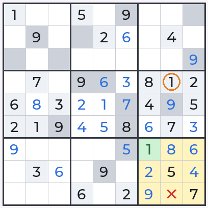

#### Step 23: the 1 in box 3

Box 3 needs a 1. r1c7, r1c8 and r1c9: row 1 has one (r1c1). r2c7 and r3c7: column 7 has one (r7c7). r3c8: column 8 has one (r4c8). Only **r2c9** is left: **r2c9 = 1**.

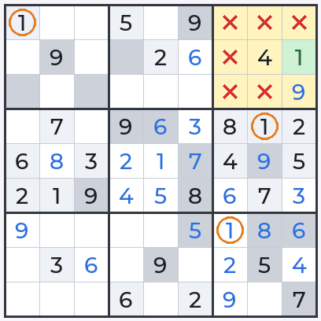

#### Step 24: the 8 in box 3

Box 3 needs an 8. r1c7, r2c7 and r3c7: column 7 has one (r4c7). r1c8 and r3c8: column 8 has one (r7c8). Only **r1c9** is left: **r1c9 = 8**.

#### Step 25: the 1 in box 7

Box 7 needs a 1. r7c2 and r7c3: row 7 has one (r7c7). r8c1 and r9c1: column 1 has one (r1c1). r9c2: column 2 has one (r6c2). Only **r9c3** is left: **r9c3 = 1**.

#### Step 26: the 3 in box 9

Box 9 needs a 3, and r9c8 is its last empty cell: **r9c8 = 3**.

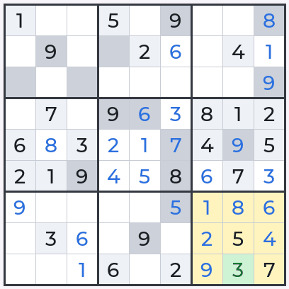

#### Step 27: the 7 in column 5

Column 5 needs a 7. r9c5: row 9 has one (r9c9). r3c5: it's white, so it's smaller than the grey 6 in r4c5 next to it. r7c5: it's white, so it's smaller than the grey 5 in r7c6 next to it. Only **r1c5** is left: **r1c5 = 7**.

#### Step 28: the 3 in row 1

Row 1 needs a 3. r1c2: column 2 has one (r8c2). r1c3: column 3 has one (r5c3). r1c8: column 8 has one (r9c8). Only **r1c7** is left: **r1c7 = 3**.

#### Step 29: the 3 in row 2

Row 2 needs a 3. r2c3: column 3 has one (r5c3). r2c7: column 7 has one (r1c7). r2c4: it's grey, so it's bigger than the white 5 in r1c4 next to it. Only **r2c1** is left: **r2c1 = 3**.

#### Step 30: the 8 in column 5

Column 5 needs an 8. r7c5: row 7 has one (r7c8). r3c5: it's white, so it's smaller than the grey 6 in r4c5 next to it. Only **r9c5** is left: **r9c5 = 8**.

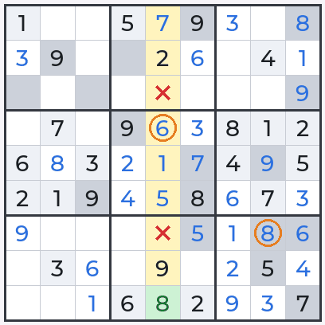

#### Step 31: the 8 in box 7

Box 7 needs an 8. r7c2 and r7c3: row 7 has one (r7c8). r9c1 and r9c2: row 9 has one (r9c5). Only **r8c1** is left: **r8c1 = 8**.

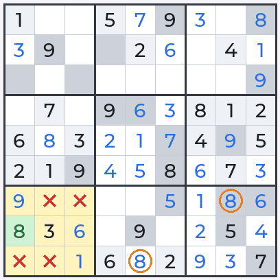

#### Step 32: the 7 in box 7

Box 7 needs a 7. r7c2: column 2 has one (r4c2). r9c1 and r9c2: row 9 has one (r9c9). Only **r7c3** is left: **r7c3 = 7**.

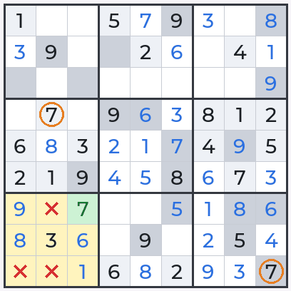

#### Step 33: the 7 in box 1

Box 1 needs a 7. r1c2 and r1c3: row 1 has one (r1c5). r2c3 and r3c3: column 3 has one (r7c3). r3c2: column 2 has one (r4c2). Only **r3c1** is left: **r3c1 = 7**.

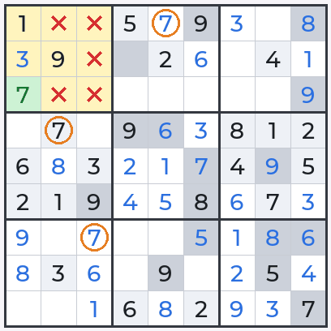

#### Step 34: the 7 in box 3

Box 3 needs a 7. r1c8: row 1 has one (r1c5). r3c7 and r3c8: row 3 has one (r3c1). Only **r2c7** is left: **r2c7 = 7**.

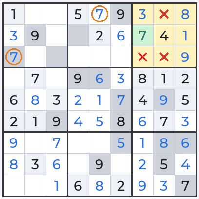

#### Step 35: the 5 in box 3

Box 3 needs a 5. r1c8: row 1 has one (r1c4). r3c8: column 8 has one (r8c8). Only **r3c7** is left: **r3c7 = 5**.

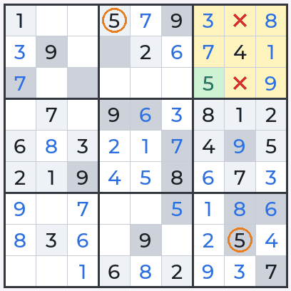

#### Step 36: the 5 in box 1

Box 1 needs a 5. r1c2 and r1c3: row 1 has one (r1c4). r3c2 and r3c3: row 3 has one (r3c7). Only **r2c3** is left: **r2c3 = 5**.

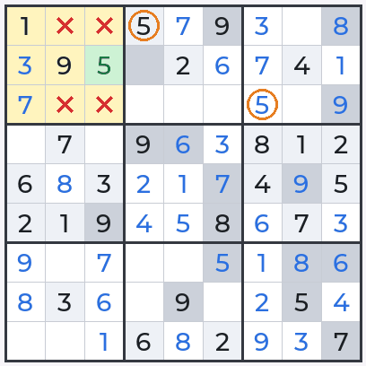

#### Step 37: the 8 in box 1

Box 1 needs an 8. r1c2 and r1c3: row 1 has one (r1c9). r3c2: column 2 has one (r5c2). Only **r3c3** is left: **r3c3 = 8**.

#### Step 38: the 8 in box 2

Box 2 needs an 8. r3c4, r3c5 and r3c6: row 3 has one (r3c3). Only **r2c4** is left: **r2c4 = 8**.

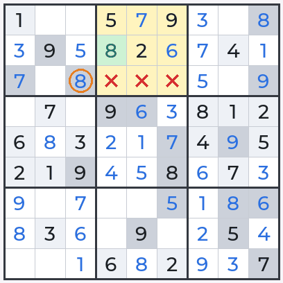

#### Step 39: the 5 in box 4

Box 4 needs a 5. r4c3: column 3 has one (r2c3). Only **r4c1** is left: **r4c1 = 5**.

#### Step 40: the 4 in box 4

Box 4 needs a 4, and r4c3 is its last empty cell: **r4c3 = 4**.

#### Step 41: the 2 in box 7

Box 7 needs a 2. r9c1 and r9c2: row 9 has one (r9c6). Only **r7c2** is left: **r7c2 = 2**.

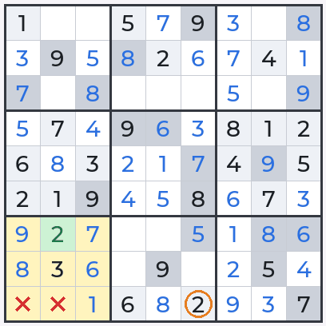

#### Step 42: the 2 in box 1

Box 1 needs a 2. r1c2 and r3c2: column 2 has one (r7c2). Only **r1c3** is left: **r1c3 = 2**.

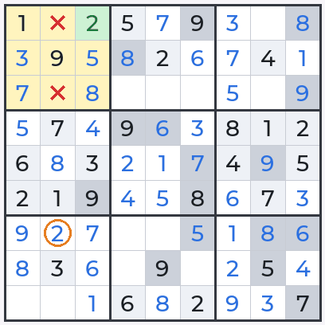

#### Step 43: the 2 in box 3

Box 3 needs a 2. r1c8: row 1 has one (r1c3). Only **r3c8** is left: **r3c8 = 2**.

#### Step 44: the 6 in box 3

Box 3 needs a 6, and r1c8 is its last empty cell: **r1c8 = 6**.

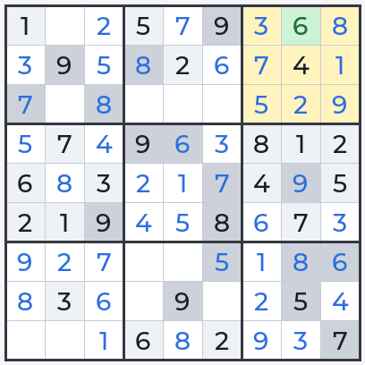

#### Step 45: the 6 in box 1

Box 1 needs a 6. r1c2: row 1 has one (r1c8). Only **r3c2** is left: **r3c2 = 6**.

#### Step 46: the 4 in box 1

Box 1 needs a 4, and r1c2 is its last empty cell: **r1c2 = 4**.

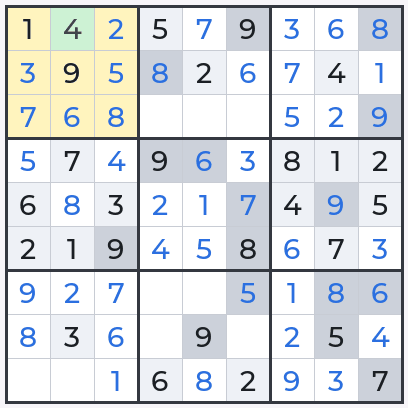

#### Step 47: the 4 in box 7

Box 7 needs a 4. r9c2: column 2 has one (r1c2). Only **r9c1** is left: **r9c1 = 4**.

#### Step 48: the 5 in box 7

Box 7 needs a 5, and r9c2 is its last empty cell: **r9c2 = 5**.

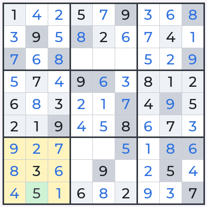

#### Step 49: the 4 in box 8

Box 8 needs a 4. r7c4: column 4 has one (r6c4). r8c4 and r8c6: row 8 has one (r8c9). Only **r7c5** is left: **r7c5 = 4**.

#### Step 50: the 4 in box 2

Box 2 needs a 4. r3c4: column 4 has one (r6c4). r3c5: column 5 has one (r7c5). Only **r3c6** is left: **r3c6 = 4**.

#### Step 51: the 1 in box 2

Box 2 needs a 1. r3c5: column 5 has one (r5c5). Only **r3c4** is left: **r3c4 = 1**.

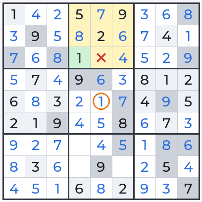

#### Step 52: the 3 in box 2

Box 2 needs a 3, and r3c5 is its last empty cell: **r3c5 = 3**.

#### Step 53: the 1 in box 8

Box 8 needs a 1. r7c4: row 7 has one (r7c7). r8c4: column 4 has one (r3c4). Only **r8c6** is left: **r8c6 = 1**.

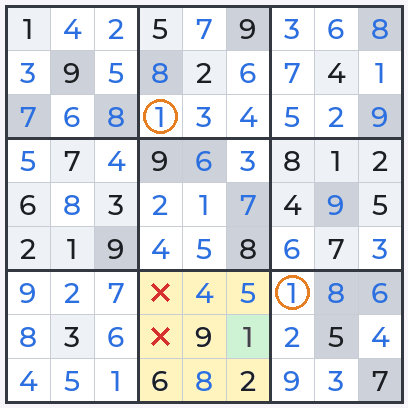

#### Step 54: the 3 in box 8

Box 8 needs a 3. r8c4: row 8 has one (r8c2). Only **r7c4** is left: **r7c4 = 3**.

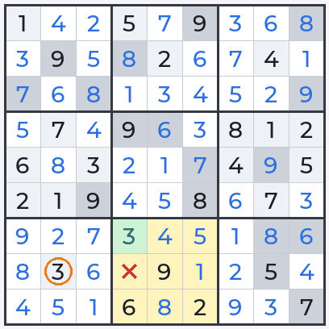

#### Step 55: the 7 in box 8

Box 8 needs a 7, and r8c4 is its last empty cell: **r8c4 = 7**.

Solved.

<!-- /walkthrough -->
