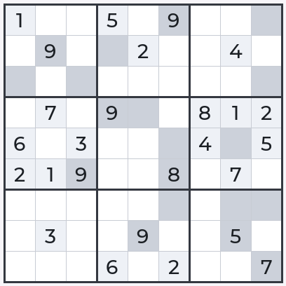

# Fortress

[← All variants](README.md) · [Puzzles](../features-puzzles.md) · [How to play](../how-to-play.md)

## The rules

[Classic](classic.md) rules, plus **grey cells**: each grey cell holds a **bigger digit than every white cell side by side with it** (left, right, above, below). Two grey cells side by side can be either way round, and cells that only touch at a corner don't count.

## On the board

- Grey cells are shaded, a little darker than Even-Odd's even cells; there are no signs to read.
- A grey 1 turns red at once (it can't beat anything); a grey digit and a white neighbour that's bigger turn red together.
- The grader and hints narrow the cells around the grey ones: "The grey cells (bigger than their white neighbours) around row 5, column 6 leave it only 7".
- **Puzzles → ⋮ → New puzzle → Marks → Fortress**: 18 to 24 grey cells.

## How to solve it

- **Grey is never 1, white next to grey is never 9.** Rule those out first.
- **Count the white neighbours:** a grey cell with white cells on both sides in its row (or column) beats two different digits, so it's at least 3; the more white neighbours, the higher it starts.
- **Look from the white side too:** a white cell next to a grey 5 is at most 4; next to two grey cells, it's below the smaller of them.
- **The 9s are grey or far from grey:** a 9 in a white cell can't be next to any grey one.

## Worked example

**variant-examples #41**, Fortress Easy (see [Classic](classic.md#worked-example-the-whole-puzzle) for how to import the examples; cells are written r*row*c*column*). The grey cells are in the screenshot; these matter here:

- r5c6 is grey, next to the white 4 in r5c7;
- r8c8 (a 5) is grey, with white cells to its left (r8c7) and right (r8c9) and below it (r9c8).

**Step 1: r5c6, a grey cell.** Row 5 has 3, 4, 5 and 6; column 6 has 2, 8 and 9; that leaves 1 and 7. r5c6 is grey and r5c7 next to it is a white 4, so it's bigger than 4. **r5c6 = 7**.

**Step 2: r9c8, under a grey 5.** Row 9 has 2, 6 and 7; column 8 has 1, 4 and 5; that leaves 3, 8 and 9. r9c8 is white, and the grey 5 above it in r8c8 must be bigger, so it's smaller than 5. **r9c8 = 3**.

**Step 3: the 6 in row 8.** Row 8 needs a 6. r8c1, r8c4 and r8c6 see the 6s in column 1, column 4 and box 8; r8c2, r8c5 and r8c8 are filled. r8c7 and r8c9 are white cells either side of the grey 5 in r8c8, so they're smaller than 5. Only **r8c3** is left: **r8c3 = 6**.

## The whole puzzle, step by step

<!-- walkthrough -->
<!-- Written by tools/walkthrough.py fortress: edit the script, not this part. -->

The whole puzzle, from the start to the last cell: 55 steps, each one a single (one place left for a digit, or one digit left for a cell), taken in the order a box's single comes first, so not quite the order of the worked example above. Each step has a page of its own, with **Previous** and **Next**: pick one from the list below. In each picture, the unit the step looks at is tinted yellow (for a cell with one digit left: its row, column and box), the new digit is on green, the digits that rule cells out have an **orange ring**, and the empty cells they rule out a **red cross**. Givens are on grey, digits from earlier steps in blue.

1. [the 8 in box 4](fortress/step-01.md)
2. [the 2 in box 5](fortress/step-02.md)
3. [the 1 in box 5](fortress/step-03.md)
4. [the 7 in box 5](fortress/step-04.md)
5. [the 9 in box 6](fortress/step-05.md)
6. [the 5 in row 6](fortress/step-06.md)
7. [the 5 in box 8](fortress/step-07.md)
8. [the 6 in box 9](fortress/step-08.md)
9. [the 6 in box 6](fortress/step-09.md)
10. [the 3 in box 6](fortress/step-10.md)
11. [the 6 in box 7](fortress/step-11.md)
12. [the 4 in box 9](fortress/step-12.md)
13. [the 8 in box 9](fortress/step-13.md)
14. [the 9 in box 9](fortress/step-14.md)
15. [the 9 in box 3](fortress/step-15.md)
16. [the 9 in box 7](fortress/step-16.md)
17. [the 6 in row 2](fortress/step-17.md)
18. [the 6 in box 5](fortress/step-18.md)
19. [the 3 in box 5](fortress/step-19.md)
20. [the 4 in box 5](fortress/step-20.md)
21. [the 2 in row 8](fortress/step-21.md)
22. [the 1 in box 9](fortress/step-22.md)
23. [the 1 in box 3](fortress/step-23.md)
24. [the 8 in box 3](fortress/step-24.md)
25. [the 1 in box 7](fortress/step-25.md)
26. [the 3 in box 9](fortress/step-26.md)
27. [the 7 in column 5](fortress/step-27.md)
28. [the 3 in row 1](fortress/step-28.md)
29. [the 3 in row 2](fortress/step-29.md)
30. [the 8 in column 5](fortress/step-30.md)
31. [the 8 in box 7](fortress/step-31.md)
32. [the 7 in box 7](fortress/step-32.md)
33. [the 7 in box 1](fortress/step-33.md)
34. [the 7 in box 3](fortress/step-34.md)
35. [the 5 in box 3](fortress/step-35.md)
36. [the 5 in box 1](fortress/step-36.md)
37. [the 8 in box 1](fortress/step-37.md)
38. [the 8 in box 2](fortress/step-38.md)
39. [the 5 in box 4](fortress/step-39.md)
40. [the 4 in box 4](fortress/step-40.md)
41. [the 2 in box 7](fortress/step-41.md)
42. [the 2 in box 1](fortress/step-42.md)
43. [the 2 in box 3](fortress/step-43.md)
44. [the 6 in box 3](fortress/step-44.md)
45. [the 6 in box 1](fortress/step-45.md)
46. [the 4 in box 1](fortress/step-46.md)
47. [the 4 in box 7](fortress/step-47.md)
48. [the 5 in box 7](fortress/step-48.md)
49. [the 4 in box 8](fortress/step-49.md)
50. [the 4 in box 2](fortress/step-50.md)
51. [the 1 in box 2](fortress/step-51.md)
52. [the 3 in box 2](fortress/step-52.md)
53. [the 1 in box 8](fortress/step-53.md)
54. [the 3 in box 8](fortress/step-54.md)
55. [the 7 in box 8](fortress/step-55.md)

Solved.

<!-- /walkthrough -->
