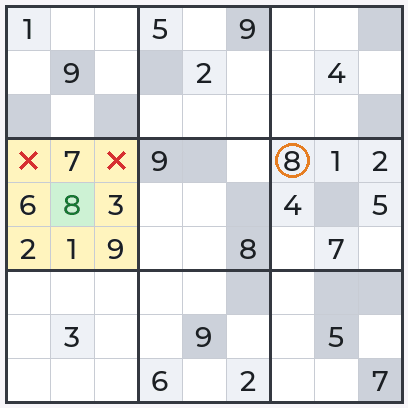

<!-- Written by tools/walkthrough.py fortress: edit the script, not this page. -->
# Fortress, step 1: the 8 in box 4

**Step 1 of 55** · [← The start](../fortress.md#the-whole-puzzle-step-by-step) · [All steps](../fortress.md#the-whole-puzzle-step-by-step) · [Step 2 →](step-02.md)

Box 4 needs an 8. r4c1 and r4c3: row 4 has one (r4c7). Only **r5c2** is left: **r5c2 = 8**.

**Step 1 of 55** · [← The start](../fortress.md#the-whole-puzzle-step-by-step) · [All steps](../fortress.md#the-whole-puzzle-step-by-step) · [Step 2 →](step-02.md)
