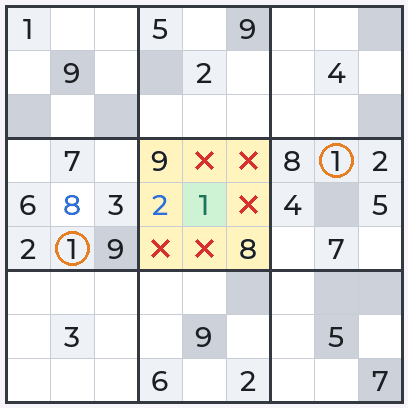

<!-- Written by tools/walkthrough.py fortress: edit the script, not this page. -->
# Fortress, step 3: the 1 in box 5

**Step 3 of 55** · [← Step 2](step-02.md) · [All steps](../fortress.md#the-whole-puzzle-step-by-step) · [Step 4 →](step-04.md)

Box 5 needs a 1. r4c5 and r4c6: row 4 has one (r4c8). r6c4 and r6c5: row 6 has one (r6c2). r5c6: it's grey, bigger than a white cell next to it, so it isn't 1. Only **r5c5** is left: **r5c5 = 1**.

**Step 3 of 55** · [← Step 2](step-02.md) · [All steps](../fortress.md#the-whole-puzzle-step-by-step) · [Step 4 →](step-04.md)
