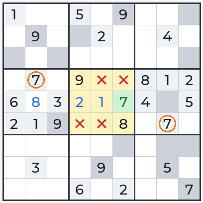

<!-- Written by tools/walkthrough.py fortress: edit the script, not this page. -->
# Fortress, step 4: the 7 in box 5

**Step 4 of 55** · [← Step 3](step-03.md) · [All steps](../fortress.md#the-whole-puzzle-step-by-step) · [Step 5 →](step-05.md)

Box 5 needs a 7. r4c5 and r4c6: row 4 has one (r4c2). r6c4 and r6c5: row 6 has one (r6c8). Only **r5c6** is left: **r5c6 = 7**.

**Step 4 of 55** · [← Step 3](step-03.md) · [All steps](../fortress.md#the-whole-puzzle-step-by-step) · [Step 5 →](step-05.md)
