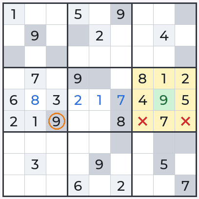

<!-- Written by tools/walkthrough.py fortress: edit the script, not this page. -->
# Fortress, step 5: the 9 in box 6

**Step 5 of 55** · [← Step 4](step-04.md) · [All steps](../fortress.md#the-whole-puzzle-step-by-step) · [Step 6 →](step-06.md)

Box 6 needs a 9. r6c7 and r6c9: row 6 has one (r6c3). Only **r5c8** is left: **r5c8 = 9**.

**Step 5 of 55** · [← Step 4](step-04.md) · [All steps](../fortress.md#the-whole-puzzle-step-by-step) · [Step 6 →](step-06.md)
