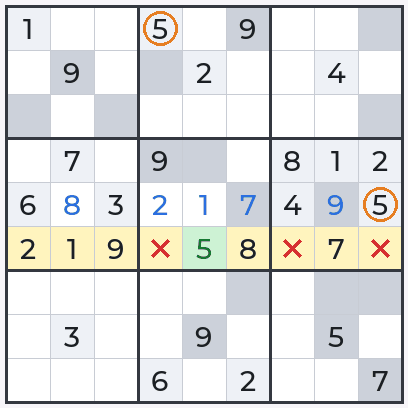

<!-- Written by tools/walkthrough.py fortress: edit the script, not this page. -->
# Fortress, step 6: the 5 in row 6

**Step 6 of 55** · [← Step 5](step-05.md) · [All steps](../fortress.md#the-whole-puzzle-step-by-step) · [Step 7 →](step-07.md)

Row 6 needs a 5. r6c4: column 4 has one (r1c4). r6c7: box 6 has one (r5c9). r6c9: column 9 has one (r5c9). Only **r6c5** is left: **r6c5 = 5**.

**Step 6 of 55** · [← Step 5](step-05.md) · [All steps](../fortress.md#the-whole-puzzle-step-by-step) · [Step 7 →](step-07.md)
