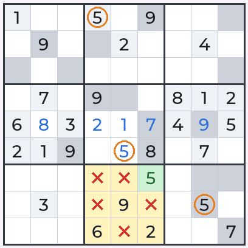

<!-- Written by tools/walkthrough.py fortress: edit the script, not this page. -->
# Fortress, step 7: the 5 in box 8

**Step 7 of 55** · [← Step 6](step-06.md) · [All steps](../fortress.md#the-whole-puzzle-step-by-step) · [Step 8 →](step-08.md)

Box 8 needs a 5. r7c4: column 4 has one (r1c4). r7c5 and r9c5: column 5 has one (r6c5). r8c4 and r8c6: row 8 has one (r8c8). Only **r7c6** is left: **r7c6 = 5**.

**Step 7 of 55** · [← Step 6](step-06.md) · [All steps](../fortress.md#the-whole-puzzle-step-by-step) · [Step 8 →](step-08.md)
