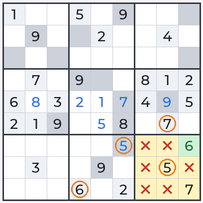

<!-- Written by tools/walkthrough.py fortress: edit the script, not this page. -->
# Fortress, step 8: the 6 in box 9

**Step 8 of 55** · [← Step 7](step-07.md) · [All steps](../fortress.md#the-whole-puzzle-step-by-step) · [Step 9 →](step-09.md)

Box 9 needs a 6. r9c7 and r9c8: row 9 has one (r9c4). r7c7: it's white, so it's smaller than the grey 5 in r7c6 next to it. r7c8: it's grey, so it's bigger than the white 7 in r6c8 next to it. r8c7 and r8c9: it's white, so it's smaller than the grey 5 in r8c8 next to it. Only **r7c9** is left: **r7c9 = 6**.

**Step 8 of 55** · [← Step 7](step-07.md) · [All steps](../fortress.md#the-whole-puzzle-step-by-step) · [Step 9 →](step-09.md)
