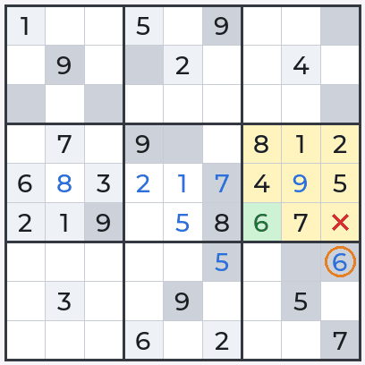

<!-- Written by tools/walkthrough.py fortress: edit the script, not this page. -->
# Fortress, step 9: the 6 in box 6

**Step 9 of 55** · [← Step 8](step-08.md) · [All steps](../fortress.md#the-whole-puzzle-step-by-step) · [Step 10 →](step-10.md)

Box 6 needs a 6. r6c9: column 9 has one (r7c9). Only **r6c7** is left: **r6c7 = 6**.

**Step 9 of 55** · [← Step 8](step-08.md) · [All steps](../fortress.md#the-whole-puzzle-step-by-step) · [Step 10 →](step-10.md)
