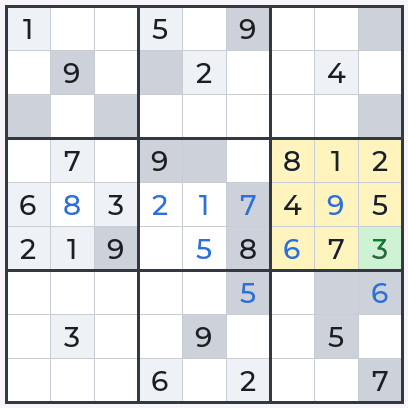

<!-- Written by tools/walkthrough.py fortress: edit the script, not this page. -->
# Fortress, step 10: the 3 in box 6

**Step 10 of 55** · [← Step 9](step-09.md) · [All steps](../fortress.md#the-whole-puzzle-step-by-step) · [Step 11 →](step-11.md)

Box 6 needs a 3, and r6c9 is its last empty cell: **r6c9 = 3**.

**Step 10 of 55** · [← Step 9](step-09.md) · [All steps](../fortress.md#the-whole-puzzle-step-by-step) · [Step 11 →](step-11.md)
