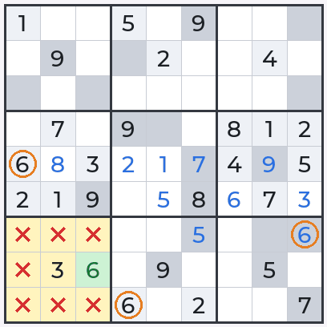

<!-- Written by tools/walkthrough.py fortress: edit the script, not this page. -->
# Fortress, step 11: the 6 in box 7

**Step 11 of 55** · [← Step 10](step-10.md) · [All steps](../fortress.md#the-whole-puzzle-step-by-step) · [Step 12 →](step-12.md)

Box 7 needs a 6. r7c1, r7c2 and r7c3: row 7 has one (r7c9). r8c1: column 1 has one (r5c1). r9c1, r9c2 and r9c3: row 9 has one (r9c4). Only **r8c3** is left: **r8c3 = 6**.

**Step 11 of 55** · [← Step 10](step-10.md) · [All steps](../fortress.md#the-whole-puzzle-step-by-step) · [Step 12 →](step-12.md)
