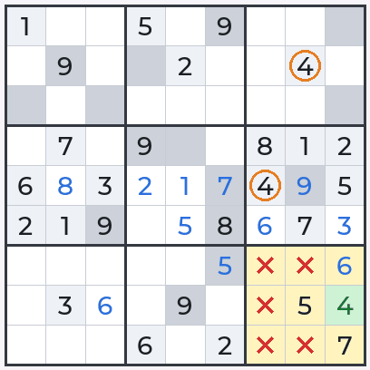

<!-- Written by tools/walkthrough.py fortress: edit the script, not this page. -->
# Fortress, step 12: the 4 in box 9

**Step 12 of 55** · [← Step 11](step-11.md) · [All steps](../fortress.md#the-whole-puzzle-step-by-step) · [Step 13 →](step-13.md)

Box 9 needs a 4. r7c7, r8c7 and r9c7: column 7 has one (r5c7). r7c8 and r9c8: column 8 has one (r2c8). Only **r8c9** is left: **r8c9 = 4**.

**Step 12 of 55** · [← Step 11](step-11.md) · [All steps](../fortress.md#the-whole-puzzle-step-by-step) · [Step 13 →](step-13.md)
