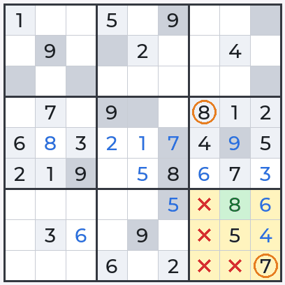

<!-- Written by tools/walkthrough.py fortress: edit the script, not this page. -->
# Fortress, step 13: the 8 in box 9

**Step 13 of 55** · [← Step 12](step-12.md) · [All steps](../fortress.md#the-whole-puzzle-step-by-step) · [Step 14 →](step-14.md)

Box 9 needs an 8. r7c7, r8c7 and r9c7: column 7 has one (r4c7). r9c8: it's white, so it's smaller than the grey 7 in r9c9 next to it. Only **r7c8** is left: **r7c8 = 8**.

**Step 13 of 55** · [← Step 12](step-12.md) · [All steps](../fortress.md#the-whole-puzzle-step-by-step) · [Step 14 →](step-14.md)
