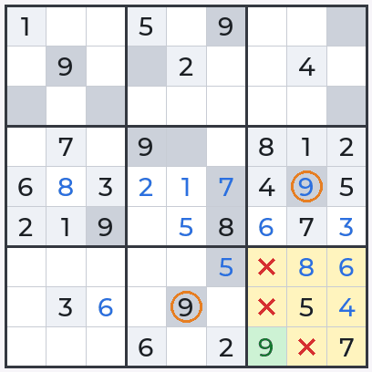

<!-- Written by tools/walkthrough.py fortress: edit the script, not this page. -->
# Fortress, step 14: the 9 in box 9

**Step 14 of 55** · [← Step 13](step-13.md) · [All steps](../fortress.md#the-whole-puzzle-step-by-step) · [Step 15 →](step-15.md)

Box 9 needs a 9. r8c7: row 8 has one (r8c5). r9c8: column 8 has one (r5c8). r7c7: it's next to a grey cell, which is bigger, so it isn't 9. Only **r9c7** is left: **r9c7 = 9**.

**Step 14 of 55** · [← Step 13](step-13.md) · [All steps](../fortress.md#the-whole-puzzle-step-by-step) · [Step 15 →](step-15.md)
