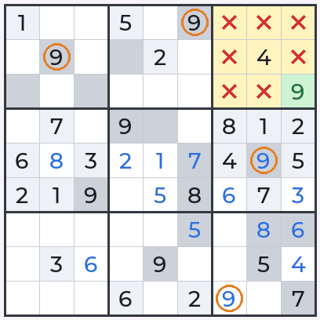

<!-- Written by tools/walkthrough.py fortress: edit the script, not this page. -->
# Fortress, step 15: the 9 in box 3

**Step 15 of 55** · [← Step 14](step-14.md) · [All steps](../fortress.md#the-whole-puzzle-step-by-step) · [Step 16 →](step-16.md)

Box 3 needs a 9. r1c7, r1c8 and r1c9: row 1 has one (r1c6). r2c7 and r2c9: row 2 has one (r2c2). r3c7: column 7 has one (r9c7). r3c8: column 8 has one (r5c8). Only **r3c9** is left: **r3c9 = 9**.

**Step 15 of 55** · [← Step 14](step-14.md) · [All steps](../fortress.md#the-whole-puzzle-step-by-step) · [Step 16 →](step-16.md)
