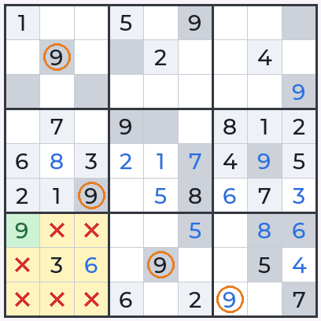

<!-- Written by tools/walkthrough.py fortress: edit the script, not this page. -->
# Fortress, step 16: the 9 in box 7

**Step 16 of 55** · [← Step 15](step-15.md) · [All steps](../fortress.md#the-whole-puzzle-step-by-step) · [Step 17 →](step-17.md)

Box 7 needs a 9. r7c2: column 2 has one (r2c2). r7c3: column 3 has one (r6c3). r8c1: row 8 has one (r8c5). r9c1, r9c2 and r9c3: row 9 has one (r9c7). Only **r7c1** is left: **r7c1 = 9**.

**Step 16 of 55** · [← Step 15](step-15.md) · [All steps](../fortress.md#the-whole-puzzle-step-by-step) · [Step 17 →](step-17.md)
