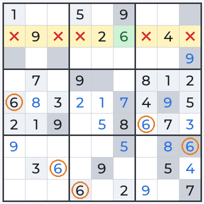

<!-- Written by tools/walkthrough.py fortress: edit the script, not this page. -->
# Fortress, step 17: the 6 in row 2

**Step 17 of 55** · [← Step 16](step-16.md) · [All steps](../fortress.md#the-whole-puzzle-step-by-step) · [Step 18 →](step-18.md)

Row 2 needs a 6. r2c1: column 1 has one (r5c1). r2c3: column 3 has one (r8c3). r2c4: column 4 has one (r9c4). r2c7: column 7 has one (r6c7). r2c9: column 9 has one (r7c9). Only **r2c6** is left: **r2c6 = 6**.

**Step 17 of 55** · [← Step 16](step-16.md) · [All steps](../fortress.md#the-whole-puzzle-step-by-step) · [Step 18 →](step-18.md)
