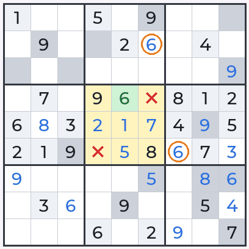

<!-- Written by tools/walkthrough.py fortress: edit the script, not this page. -->
# Fortress, step 18: the 6 in box 5

**Step 18 of 55** · [← Step 17](step-17.md) · [All steps](../fortress.md#the-whole-puzzle-step-by-step) · [Step 19 →](step-19.md)

Box 5 needs a 6. r4c6: column 6 has one (r2c6). r6c4: row 6 has one (r6c7). Only **r4c5** is left: **r4c5 = 6**.

**Step 18 of 55** · [← Step 17](step-17.md) · [All steps](../fortress.md#the-whole-puzzle-step-by-step) · [Step 19 →](step-19.md)
