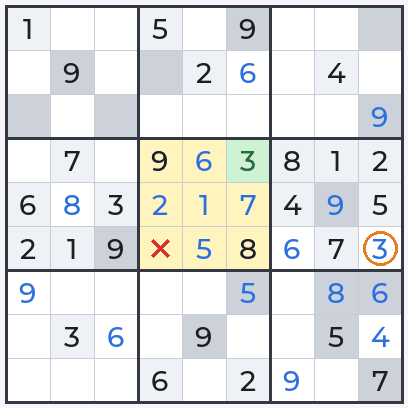

<!-- Written by tools/walkthrough.py fortress: edit the script, not this page. -->
# Fortress, step 19: the 3 in box 5

**Step 19 of 55** · [← Step 18](step-18.md) · [All steps](../fortress.md#the-whole-puzzle-step-by-step) · [Step 20 →](step-20.md)

Box 5 needs a 3. r6c4: row 6 has one (r6c9). Only **r4c6** is left: **r4c6 = 3**.

**Step 19 of 55** · [← Step 18](step-18.md) · [All steps](../fortress.md#the-whole-puzzle-step-by-step) · [Step 20 →](step-20.md)
