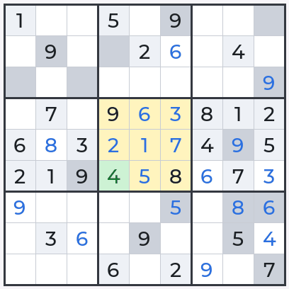

<!-- Written by tools/walkthrough.py fortress: edit the script, not this page. -->
# Fortress, step 20: the 4 in box 5

**Step 20 of 55** · [← Step 19](step-19.md) · [All steps](../fortress.md#the-whole-puzzle-step-by-step) · [Step 21 →](step-21.md)

Box 5 needs a 4, and r6c4 is its last empty cell: **r6c4 = 4**.

**Step 20 of 55** · [← Step 19](step-19.md) · [All steps](../fortress.md#the-whole-puzzle-step-by-step) · [Step 21 →](step-21.md)
