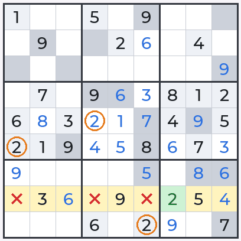

<!-- Written by tools/walkthrough.py fortress: edit the script, not this page. -->
# Fortress, step 21: the 2 in row 8

**Step 21 of 55** · [← Step 20](step-20.md) · [All steps](../fortress.md#the-whole-puzzle-step-by-step) · [Step 22 →](step-22.md)

Row 8 needs a 2. r8c1: column 1 has one (r6c1). r8c4: column 4 has one (r5c4). r8c6: column 6 has one (r9c6). Only **r8c7** is left: **r8c7 = 2**.

**Step 21 of 55** · [← Step 20](step-20.md) · [All steps](../fortress.md#the-whole-puzzle-step-by-step) · [Step 22 →](step-22.md)
