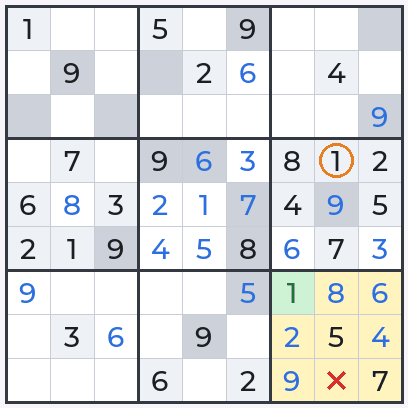

<!-- Written by tools/walkthrough.py fortress: edit the script, not this page. -->
# Fortress, step 22: the 1 in box 9

**Step 22 of 55** · [← Step 21](step-21.md) · [All steps](../fortress.md#the-whole-puzzle-step-by-step) · [Step 23 →](step-23.md)

Box 9 needs a 1. r9c8: column 8 has one (r4c8). Only **r7c7** is left: **r7c7 = 1**.

**Step 22 of 55** · [← Step 21](step-21.md) · [All steps](../fortress.md#the-whole-puzzle-step-by-step) · [Step 23 →](step-23.md)
