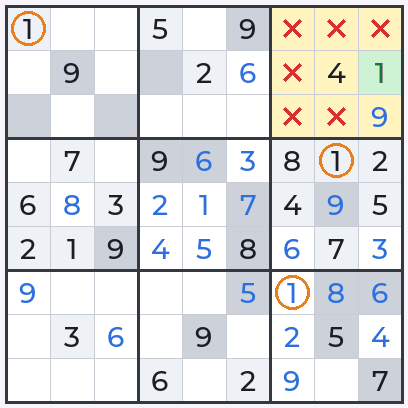

<!-- Written by tools/walkthrough.py fortress: edit the script, not this page. -->
# Fortress, step 23: the 1 in box 3

**Step 23 of 55** · [← Step 22](step-22.md) · [All steps](../fortress.md#the-whole-puzzle-step-by-step) · [Step 24 →](step-24.md)

Box 3 needs a 1. r1c7, r1c8 and r1c9: row 1 has one (r1c1). r2c7 and r3c7: column 7 has one (r7c7). r3c8: column 8 has one (r4c8). Only **r2c9** is left: **r2c9 = 1**.

**Step 23 of 55** · [← Step 22](step-22.md) · [All steps](../fortress.md#the-whole-puzzle-step-by-step) · [Step 24 →](step-24.md)
