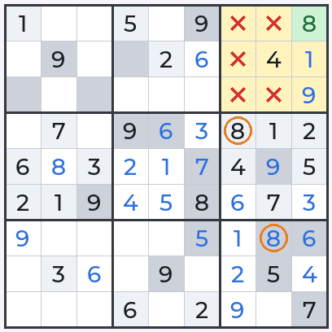

<!-- Written by tools/walkthrough.py fortress: edit the script, not this page. -->
# Fortress, step 24: the 8 in box 3

**Step 24 of 55** · [← Step 23](step-23.md) · [All steps](../fortress.md#the-whole-puzzle-step-by-step) · [Step 25 →](step-25.md)

Box 3 needs an 8. r1c7, r2c7 and r3c7: column 7 has one (r4c7). r1c8 and r3c8: column 8 has one (r7c8). Only **r1c9** is left: **r1c9 = 8**.

**Step 24 of 55** · [← Step 23](step-23.md) · [All steps](../fortress.md#the-whole-puzzle-step-by-step) · [Step 25 →](step-25.md)
