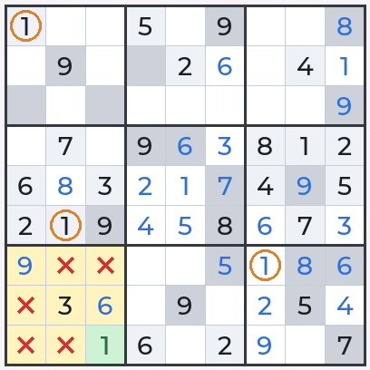

<!-- Written by tools/walkthrough.py fortress: edit the script, not this page. -->
# Fortress, step 25: the 1 in box 7

**Step 25 of 55** · [← Step 24](step-24.md) · [All steps](../fortress.md#the-whole-puzzle-step-by-step) · [Step 26 →](step-26.md)

Box 7 needs a 1. r7c2 and r7c3: row 7 has one (r7c7). r8c1 and r9c1: column 1 has one (r1c1). r9c2: column 2 has one (r6c2). Only **r9c3** is left: **r9c3 = 1**.

**Step 25 of 55** · [← Step 24](step-24.md) · [All steps](../fortress.md#the-whole-puzzle-step-by-step) · [Step 26 →](step-26.md)
