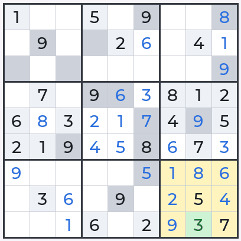

<!-- Written by tools/walkthrough.py fortress: edit the script, not this page. -->
# Fortress, step 26: the 3 in box 9

**Step 26 of 55** · [← Step 25](step-25.md) · [All steps](../fortress.md#the-whole-puzzle-step-by-step) · [Step 27 →](step-27.md)

Box 9 needs a 3, and r9c8 is its last empty cell: **r9c8 = 3**.

**Step 26 of 55** · [← Step 25](step-25.md) · [All steps](../fortress.md#the-whole-puzzle-step-by-step) · [Step 27 →](step-27.md)
