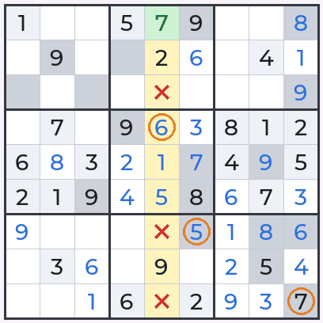

<!-- Written by tools/walkthrough.py fortress: edit the script, not this page. -->
# Fortress, step 27: the 7 in column 5

**Step 27 of 55** · [← Step 26](step-26.md) · [All steps](../fortress.md#the-whole-puzzle-step-by-step) · [Step 28 →](step-28.md)

Column 5 needs a 7. r9c5: row 9 has one (r9c9). r3c5: it's white, so it's smaller than the grey 6 in r4c5 next to it. r7c5: it's white, so it's smaller than the grey 5 in r7c6 next to it. Only **r1c5** is left: **r1c5 = 7**.

**Step 27 of 55** · [← Step 26](step-26.md) · [All steps](../fortress.md#the-whole-puzzle-step-by-step) · [Step 28 →](step-28.md)
