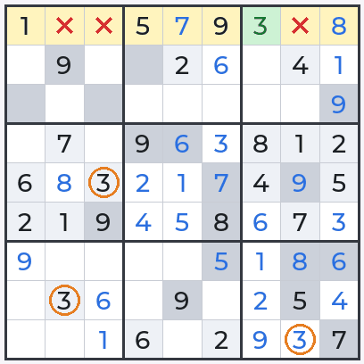

<!-- Written by tools/walkthrough.py fortress: edit the script, not this page. -->
# Fortress, step 28: the 3 in row 1

**Step 28 of 55** · [← Step 27](step-27.md) · [All steps](../fortress.md#the-whole-puzzle-step-by-step) · [Step 29 →](step-29.md)

Row 1 needs a 3. r1c2: column 2 has one (r8c2). r1c3: column 3 has one (r5c3). r1c8: column 8 has one (r9c8). Only **r1c7** is left: **r1c7 = 3**.

**Step 28 of 55** · [← Step 27](step-27.md) · [All steps](../fortress.md#the-whole-puzzle-step-by-step) · [Step 29 →](step-29.md)
