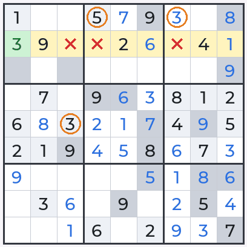

<!-- Written by tools/walkthrough.py fortress: edit the script, not this page. -->
# Fortress, step 29: the 3 in row 2

**Step 29 of 55** · [← Step 28](step-28.md) · [All steps](../fortress.md#the-whole-puzzle-step-by-step) · [Step 30 →](step-30.md)

Row 2 needs a 3. r2c3: column 3 has one (r5c3). r2c7: column 7 has one (r1c7). r2c4: it's grey, so it's bigger than the white 5 in r1c4 next to it. Only **r2c1** is left: **r2c1 = 3**.

**Step 29 of 55** · [← Step 28](step-28.md) · [All steps](../fortress.md#the-whole-puzzle-step-by-step) · [Step 30 →](step-30.md)
