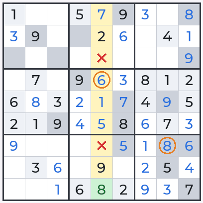

<!-- Written by tools/walkthrough.py fortress: edit the script, not this page. -->
# Fortress, step 30: the 8 in column 5

**Step 30 of 55** · [← Step 29](step-29.md) · [All steps](../fortress.md#the-whole-puzzle-step-by-step) · [Step 31 →](step-31.md)

Column 5 needs an 8. r7c5: row 7 has one (r7c8). r3c5: it's white, so it's smaller than the grey 6 in r4c5 next to it. Only **r9c5** is left: **r9c5 = 8**.

**Step 30 of 55** · [← Step 29](step-29.md) · [All steps](../fortress.md#the-whole-puzzle-step-by-step) · [Step 31 →](step-31.md)
