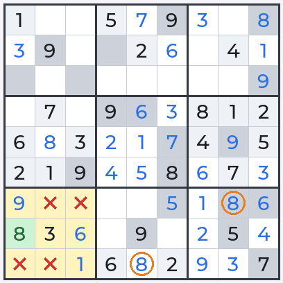

<!-- Written by tools/walkthrough.py fortress: edit the script, not this page. -->
# Fortress, step 31: the 8 in box 7

**Step 31 of 55** · [← Step 30](step-30.md) · [All steps](../fortress.md#the-whole-puzzle-step-by-step) · [Step 32 →](step-32.md)

Box 7 needs an 8. r7c2 and r7c3: row 7 has one (r7c8). r9c1 and r9c2: row 9 has one (r9c5). Only **r8c1** is left: **r8c1 = 8**.

**Step 31 of 55** · [← Step 30](step-30.md) · [All steps](../fortress.md#the-whole-puzzle-step-by-step) · [Step 32 →](step-32.md)
