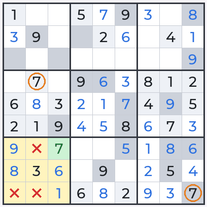

<!-- Written by tools/walkthrough.py fortress: edit the script, not this page. -->
# Fortress, step 32: the 7 in box 7

**Step 32 of 55** · [← Step 31](step-31.md) · [All steps](../fortress.md#the-whole-puzzle-step-by-step) · [Step 33 →](step-33.md)

Box 7 needs a 7. r7c2: column 2 has one (r4c2). r9c1 and r9c2: row 9 has one (r9c9). Only **r7c3** is left: **r7c3 = 7**.

**Step 32 of 55** · [← Step 31](step-31.md) · [All steps](../fortress.md#the-whole-puzzle-step-by-step) · [Step 33 →](step-33.md)
