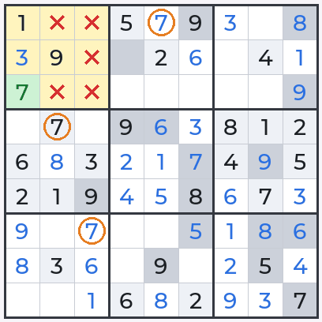

<!-- Written by tools/walkthrough.py fortress: edit the script, not this page. -->
# Fortress, step 33: the 7 in box 1

**Step 33 of 55** · [← Step 32](step-32.md) · [All steps](../fortress.md#the-whole-puzzle-step-by-step) · [Step 34 →](step-34.md)

Box 1 needs a 7. r1c2 and r1c3: row 1 has one (r1c5). r2c3 and r3c3: column 3 has one (r7c3). r3c2: column 2 has one (r4c2). Only **r3c1** is left: **r3c1 = 7**.

**Step 33 of 55** · [← Step 32](step-32.md) · [All steps](../fortress.md#the-whole-puzzle-step-by-step) · [Step 34 →](step-34.md)
