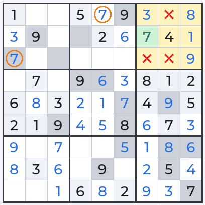

<!-- Written by tools/walkthrough.py fortress: edit the script, not this page. -->
# Fortress, step 34: the 7 in box 3

**Step 34 of 55** · [← Step 33](step-33.md) · [All steps](../fortress.md#the-whole-puzzle-step-by-step) · [Step 35 →](step-35.md)

Box 3 needs a 7. r1c8: row 1 has one (r1c5). r3c7 and r3c8: row 3 has one (r3c1). Only **r2c7** is left: **r2c7 = 7**.

**Step 34 of 55** · [← Step 33](step-33.md) · [All steps](../fortress.md#the-whole-puzzle-step-by-step) · [Step 35 →](step-35.md)
