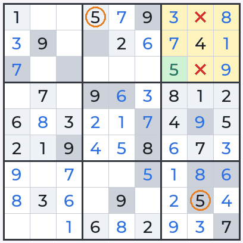

<!-- Written by tools/walkthrough.py fortress: edit the script, not this page. -->
# Fortress, step 35: the 5 in box 3

**Step 35 of 55** · [← Step 34](step-34.md) · [All steps](../fortress.md#the-whole-puzzle-step-by-step) · [Step 36 →](step-36.md)

Box 3 needs a 5. r1c8: row 1 has one (r1c4). r3c8: column 8 has one (r8c8). Only **r3c7** is left: **r3c7 = 5**.

**Step 35 of 55** · [← Step 34](step-34.md) · [All steps](../fortress.md#the-whole-puzzle-step-by-step) · [Step 36 →](step-36.md)
