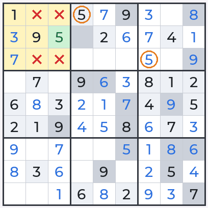

<!-- Written by tools/walkthrough.py fortress: edit the script, not this page. -->
# Fortress, step 36: the 5 in box 1

**Step 36 of 55** · [← Step 35](step-35.md) · [All steps](../fortress.md#the-whole-puzzle-step-by-step) · [Step 37 →](step-37.md)

Box 1 needs a 5. r1c2 and r1c3: row 1 has one (r1c4). r3c2 and r3c3: row 3 has one (r3c7). Only **r2c3** is left: **r2c3 = 5**.

**Step 36 of 55** · [← Step 35](step-35.md) · [All steps](../fortress.md#the-whole-puzzle-step-by-step) · [Step 37 →](step-37.md)
