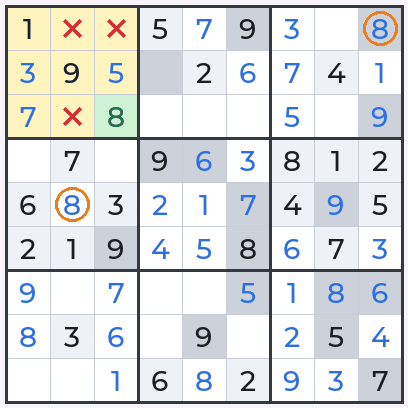

<!-- Written by tools/walkthrough.py fortress: edit the script, not this page. -->
# Fortress, step 37: the 8 in box 1

**Step 37 of 55** · [← Step 36](step-36.md) · [All steps](../fortress.md#the-whole-puzzle-step-by-step) · [Step 38 →](step-38.md)

Box 1 needs an 8. r1c2 and r1c3: row 1 has one (r1c9). r3c2: column 2 has one (r5c2). Only **r3c3** is left: **r3c3 = 8**.

**Step 37 of 55** · [← Step 36](step-36.md) · [All steps](../fortress.md#the-whole-puzzle-step-by-step) · [Step 38 →](step-38.md)
