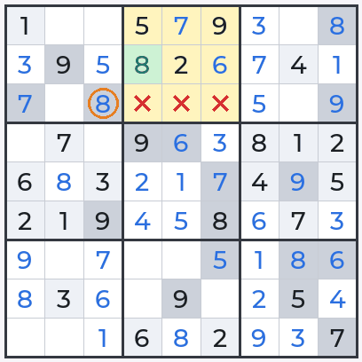

<!-- Written by tools/walkthrough.py fortress: edit the script, not this page. -->
# Fortress, step 38: the 8 in box 2

**Step 38 of 55** · [← Step 37](step-37.md) · [All steps](../fortress.md#the-whole-puzzle-step-by-step) · [Step 39 →](step-39.md)

Box 2 needs an 8. r3c4, r3c5 and r3c6: row 3 has one (r3c3). Only **r2c4** is left: **r2c4 = 8**.

**Step 38 of 55** · [← Step 37](step-37.md) · [All steps](../fortress.md#the-whole-puzzle-step-by-step) · [Step 39 →](step-39.md)
