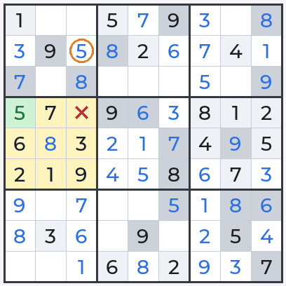

<!-- Written by tools/walkthrough.py fortress: edit the script, not this page. -->
# Fortress, step 39: the 5 in box 4

**Step 39 of 55** · [← Step 38](step-38.md) · [All steps](../fortress.md#the-whole-puzzle-step-by-step) · [Step 40 →](step-40.md)

Box 4 needs a 5. r4c3: column 3 has one (r2c3). Only **r4c1** is left: **r4c1 = 5**.

**Step 39 of 55** · [← Step 38](step-38.md) · [All steps](../fortress.md#the-whole-puzzle-step-by-step) · [Step 40 →](step-40.md)
