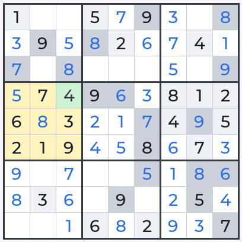

<!-- Written by tools/walkthrough.py fortress: edit the script, not this page. -->
# Fortress, step 40: the 4 in box 4

**Step 40 of 55** · [← Step 39](step-39.md) · [All steps](../fortress.md#the-whole-puzzle-step-by-step) · [Step 41 →](step-41.md)

Box 4 needs a 4, and r4c3 is its last empty cell: **r4c3 = 4**.

**Step 40 of 55** · [← Step 39](step-39.md) · [All steps](../fortress.md#the-whole-puzzle-step-by-step) · [Step 41 →](step-41.md)
