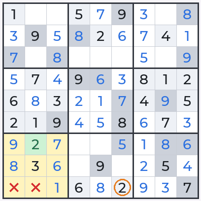

<!-- Written by tools/walkthrough.py fortress: edit the script, not this page. -->
# Fortress, step 41: the 2 in box 7

**Step 41 of 55** · [← Step 40](step-40.md) · [All steps](../fortress.md#the-whole-puzzle-step-by-step) · [Step 42 →](step-42.md)

Box 7 needs a 2. r9c1 and r9c2: row 9 has one (r9c6). Only **r7c2** is left: **r7c2 = 2**.

**Step 41 of 55** · [← Step 40](step-40.md) · [All steps](../fortress.md#the-whole-puzzle-step-by-step) · [Step 42 →](step-42.md)
