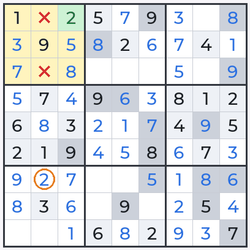

<!-- Written by tools/walkthrough.py fortress: edit the script, not this page. -->
# Fortress, step 42: the 2 in box 1

**Step 42 of 55** · [← Step 41](step-41.md) · [All steps](../fortress.md#the-whole-puzzle-step-by-step) · [Step 43 →](step-43.md)

Box 1 needs a 2. r1c2 and r3c2: column 2 has one (r7c2). Only **r1c3** is left: **r1c3 = 2**.

**Step 42 of 55** · [← Step 41](step-41.md) · [All steps](../fortress.md#the-whole-puzzle-step-by-step) · [Step 43 →](step-43.md)
