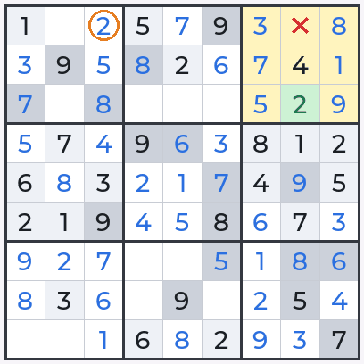

<!-- Written by tools/walkthrough.py fortress: edit the script, not this page. -->
# Fortress, step 43: the 2 in box 3

**Step 43 of 55** · [← Step 42](step-42.md) · [All steps](../fortress.md#the-whole-puzzle-step-by-step) · [Step 44 →](step-44.md)

Box 3 needs a 2. r1c8: row 1 has one (r1c3). Only **r3c8** is left: **r3c8 = 2**.

**Step 43 of 55** · [← Step 42](step-42.md) · [All steps](../fortress.md#the-whole-puzzle-step-by-step) · [Step 44 →](step-44.md)
