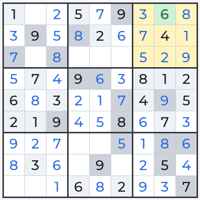

<!-- Written by tools/walkthrough.py fortress: edit the script, not this page. -->
# Fortress, step 44: the 6 in box 3

**Step 44 of 55** · [← Step 43](step-43.md) · [All steps](../fortress.md#the-whole-puzzle-step-by-step) · [Step 45 →](step-45.md)

Box 3 needs a 6, and r1c8 is its last empty cell: **r1c8 = 6**.

**Step 44 of 55** · [← Step 43](step-43.md) · [All steps](../fortress.md#the-whole-puzzle-step-by-step) · [Step 45 →](step-45.md)
