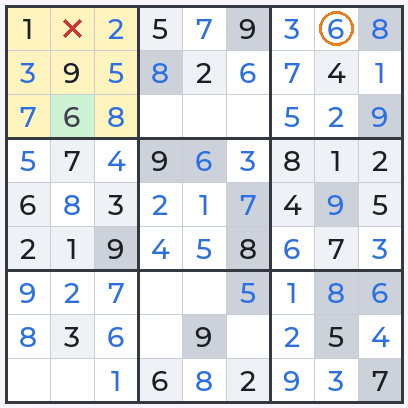

<!-- Written by tools/walkthrough.py fortress: edit the script, not this page. -->
# Fortress, step 45: the 6 in box 1

**Step 45 of 55** · [← Step 44](step-44.md) · [All steps](../fortress.md#the-whole-puzzle-step-by-step) · [Step 46 →](step-46.md)

Box 1 needs a 6. r1c2: row 1 has one (r1c8). Only **r3c2** is left: **r3c2 = 6**.

**Step 45 of 55** · [← Step 44](step-44.md) · [All steps](../fortress.md#the-whole-puzzle-step-by-step) · [Step 46 →](step-46.md)
