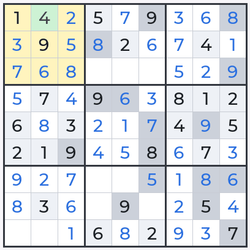

<!-- Written by tools/walkthrough.py fortress: edit the script, not this page. -->
# Fortress, step 46: the 4 in box 1

**Step 46 of 55** · [← Step 45](step-45.md) · [All steps](../fortress.md#the-whole-puzzle-step-by-step) · [Step 47 →](step-47.md)

Box 1 needs a 4, and r1c2 is its last empty cell: **r1c2 = 4**.

**Step 46 of 55** · [← Step 45](step-45.md) · [All steps](../fortress.md#the-whole-puzzle-step-by-step) · [Step 47 →](step-47.md)
